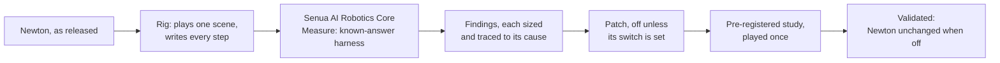

# Senua AI Robotics Core: Newton deep dive

**The Senua AI Robotics Core measured Newton, the open physics engine of NVIDIA, Google DeepMind and Disney Research,
against the answers physics gives, found where it departs from them, traced the largest to their causes in Newton's
source, and resolved 23 of its 29 issues, each in a pre-registered study: fifteen fixed with Senua AI's patches, two
with Newton's own options, three with fixes proposed upstream, two, a load not held at rest and a spinning body's
centre that moves, on every solver with Senua AI's patches and Newton's own options together, and one fixed on
Featherstone with no departure left on SemiImplicit. The other 3 are resolved in part, and 3 showed no departure where
measured. The deep dive closed on 21 October 2026 after 39 studies and 142 runs; what remains open is listed
[below](#where-the-deep-dive-closed).**

The third deep dive, after Meta's SuperDex Physics and Google DeepMind's MuJoCo. The same measurement, validation and
patching apply to any physics engine or robotics framework.

## What Senua AI found and fixed in Newton

| Newton as released (1.6.1; 1.7.0 where named) | What the Senua AI Robotics Core measured | With Senua AI |
|---|---|---|
| **SemiImplicit and Featherstone give friction far above Coulomb's limit** | A cube set sliding stops at 44% of the distance Coulomb's law gives; an impact takes 75% too much friction; with a narrower friction smoothing, a plate stops at 3.5% of its distance. The cause: the friction's direction is divided by an unscaled Huber norm, so friction is Coulomb's times 2 / v below 1 m/s | **Corrected.** Senua AI's patch gives Coulomb's friction on both solvers, the slide within 0.2% and the impact exact, whatever the smoothing. **Validated: 11 of 11 pre-registered rules** ([Study 1](docs/studies/01-coulomb-friction.md)) |
| **XPBD bounces with a restitution of 0, and its own restitution option loses friction** | Dropped with a restitution of 0, a cube rebounds 4% to 12% of the height. XPBD's own restitution option removes the bounce but cuts friction at an impact to 9% to 57% of Coulomb's on fresh scenes: its velocity pass applies normal impulses only | **Corrected.** Senua AI's patch to that pass: no bounce, and Coulomb's friction at and after an impact to 1 part in 3,500. **Validated: 9 of 9 pre-registered rules** ([Study 2](docs/studies/02-xpbd-restitution-friction.md)) |
| **SemiImplicit and Featherstone rebound with a restitution of 0** | Dropped with a restitution of 0, a cube rebounds, more as the step shrinks (2.7% of the height at 0.156 ms): the contact damps only while it closes, so the spring hands back what the damper did not take | **Corrected.** Senua AI's patch damps the contact in both phases and keeps it from pulling: no rebound at any step where Newton's explicit integration can carry the contact, nothing else changed. **Validated: 9 of 9 pre-registered rules** ([Study 3](docs/studies/03-normal-contact.md)) |
| **VBD's bodies stop falling** | Released 10 m above the ground, a body does not fall at all; 1 m up, it does not fall at a 0.031 ms step. Its free fall gets worse as the step is refined, as 32-bit positions predict | **Corrected.** The cause: VBD reads a body's velocity back from its 32-bit positions. Senua AI's patch carries it, and VBD falls exactly as Newton's other solvers do, every test it passed still passing. **Validated: 5 of 5 pre-registered rules** ([Study 4](docs/studies/04-vbd-carried-velocity.md)). VBD's other error at small steps, on a jointed chain, remains, traced to the same 32-bit positions inside its solve: a joint's motion a step falls under their spacing, so the chain departs by half its energy at 0.05 ms, with or without the patch, and by as much at 0.625 ms 100 m from the origin ([runs 045](validation/run_045_vbd_chain_float32/README.md) and [047](validation/run_047_vbd_chain_spacing/README.md)) |
| **The MuJoCo solver cannot play a slippery contact** | Its state stops being a number at a cube's first contact with the ground when the friction is 0.001 or less, with no warning: ice or a lubricated part is out of reach | **Fixed by Newton's own configuration.** Traced to the default pyramidal cone in 32-bit arithmetic, whose regularization MuJoCo Warp scales with friction squared ([runs 012](validation/run_012_mujoco_solver_cone/README.md) and [023](validation/run_023_mujoco_solver_regularization/README.md)); with `cone="elliptic"` every play at friction 0, 0.0001 and 0.001 is a number throughout and the ground carries the weight to 0.2% ([Study 9](docs/studies/09-newtons-own-options.md)) |
| A joint chain does not keep its energy | With nothing acting on a two-link chain, Featherstone and the MuJoCo solver add 9.7% of its energy in 2 s at 10 ms, exactly as MuJoCo's C engine does; XPBD and VBD take out 30% and 46%; SemiImplicit blows up at every step played | **Fixed by Newton's own configuration on two solvers** ([Study 9](docs/studies/09-newtons-own-options.md)): the MuJoCo solver's own RK4 keeps a fresh chain's energy and angular momentum within 5 ppm at every step from 8 to 0.125 ms; SemiImplicit with `joint_attach_kd=0` plays it at every step, where its explicit joint damper blew up ([run 024](validation/run_024_semi_chain_penalty/README.md)). **Fixed and validated on Featherstone** ([Study 16](docs/studies/16-featherstone-rk4.md)): Senua AI's patch makes its step as the classic Runge-Kutta scheme, a free chain kept within 7 ppm and a swinging one within 20 ppm. **Fixed and validated on VBD's compliant-ALM path** ([Study 36](docs/studies/36-vbd-pose-carry.md)): Senua AI's displacement patch and pose carry keep a chain 60 m from the origin within 2.2% of the origin's departure at every step, its loss falling with the step. **Fixed and validated on XPBD for a free chain** ([Study 38](docs/studies/38-xpbd-joint-colours-two-counts.md)): Senua AI's joint colours with XPBD's own full relaxation, the loss falling with the step to 489 ppm at 0.1 ms against 9,587 as released. VBD's legacy path far out open ([run 014](validation/run_014_chain/README.md); [Study 39](docs/studies/39-vbd-legacy-pose-carry-alpha.md): with the pose carry and Newton's own `rigid_avbd_joint_alpha=0` its loss falls with the step 50 m out, 159 ppm at 0.025 ms against 7,837 without the carry, but stays above the origin's by more than the registered tenth) |
| **Nothing holds at rest** | A load inside the friction limit creeps on every solver (XPBD in proportion to the step, mostly its solve left unconverged, [run 027](validation/run_027_xpbd_creep_iterations/README.md), the rest its friction limited by each iteration's normal correction rather than the force the contact carries, [run 044](validation/run_044_xpbd_creep_floor/README.md); SemiImplicit and Featherstone at the push over their friction stiffness where the step lets their explicit friction settle, at a chatter's speed above it), except VBD on its coming contact path at large steps | **Fixed and validated on every solver.** **On SemiImplicit and Featherstone** ([Study 18](docs/studies/18-semi-featherstone-coulomb-friction.md)): Senua AI's patches apply their friction after the step as the impulse that stops each contact's slip within Coulomb's cone; a cube held still at every step, a slide within 0.45% of Coulomb's distance, and a small cube held at a 2 ms step, where as released it is thrown (issue 9). **Fixed and validated on XPBD** ([Study 15](docs/studies/15-xpbd-holds.md)): Senua AI's patch bounds its friction on the step's totals; with the speed floor removed and 64 iterations a cube pushed at 0.7 of its friction holds within 4 um/s. **And on the MuJoCo solver** with MuJoCo's recommended elliptic cone and noslip, which Senua AI's patch passes to its CPU path ([Study 11](docs/studies/11-mujoco-noslip-cpu-featherstone-limit.md)). **And on VBD**, both its paths, by Newton's own configuration, its contact history with sticky contact matching ([Study 17](docs/studies/17-vbd-contact-history.md), [Study 19](docs/studies/19-vbd-legacy-contact-history.md)), held still at every step |
| **A spinning body's centre of mass moves** | With nothing acting on it, a cube spinning about a centre of mass 5 cm off its origin: the MuJoCo solver moves that centre 13 mm in 2 s at 10 ms, first order in the step; VBD-ALM more as the step shrinks. Featherstone keeps it within 3 um/s: the drift users reported for it does not occur in 1.6.1 | **Resolved. On the MuJoCo solver by Newton's own configuration:** its RK4 holds a fresh spinning body's centre within 19 um/s at 8, 2 and 0.5 ms ([Study 9](docs/studies/09-newtons-own-options.md); [runs 030](validation/run_030_com_offset_spin/README.md) and [031](validation/run_031_spin_drift_integrator/README.md)). **On VBD-ALM and VBD by Senua AI's patch:** VBD's rigid solve in displacement form keeps the centre still at every step, where as released it drifts at 8.2 mm/s at 0.06 ms, its contacts settling as the step shrinks ([Study 23](docs/studies/23-vbd-displacement-spin-contacts.md)) |
| **A joint limit beyond pi throws the joint** | A chain joint turning past pi inside limits of -1 and 4 rad, which it never reaches, is thrown on XPBD (its arms spin at 327,786 rad/s within 0.3 s) and on VBD, as users report for XPBD: its limit reads the angle wrapped into (-pi, pi]. SemiImplicit, Featherstone and the MuJoCo solver are unaffected | **Fixed and validated** ([Study 10](docs/studies/10-xpbd-joints-floor.md)): on XPBD by Newton's own proposed fix, pull request #4318 (its form of #4316), on VBD by Newton 1.7.0 as released; an arm turning past pi inside its limits moves as with none, to 1 urad, where XPBD as released throws it at up to 32.7 million rad/s. XPBD's limit throwing an arm back off it (issue 8) is **fixed and validated** too ([Study 20](docs/studies/20-xpbd-limit-arm-chain.md)): Senua AI's joint-angle patch, its fourth form, at 64 iterations holds an arm on its limit and stops a chain's joint dead as a hard limit does |
| **The MuJoCo solver's joint limit is not the one it is given** | An arm released onto a limit with Newton's default stiffness and damping goes 4 to 6 times further past it than the given spring and damper would let it, and rebounds higher: Newton's conversion keeps only (1 - dmax), 5%, of each | **Corrected.** Senua AI's patch converts without that factor: the arm turns back within 0.022 rad of the given spring and damper kept from pulling. **Validated: 9 of 9 pre-registered rules** ([Study 6](docs/studies/06-mujoco-limit.md)) |
| **1.7.0: Featherstone's joint limit diverges on light links** | Users report Featherstone stopping being a number on 6-axis arms the MuJoCo solver plays, a sixteenth of the step not helping. One light arm resting on its limit diverges at every step from 1/240 s to 10 us and is held at 2 us | **Fixed and validated** ([Study 12](docs/studies/12-semi-angle-featherstone-implicit-limit.md)): Senua AI's limit patch integrates Newton's limit implicitly, its force kept only where it pushes; a light arm and a serial arm resting on a limit, which as released stop being a number at every step from 1/240 s to 50 us, rest on the limit at every step. Traced to the limit's explicit integration, stable only under microseconds on light links ([run 055](validation/run_055_featherstone_limit_light_link/README.md)) |
| **1.7.0: XPBD answers a joint torque 1.75 times too strongly, its drive grows with its iterations, and it stops slow bodies** | At its default relaxations one arm under a torque turns 1.75 times as far as the closed form; a drive acts as 0.69 times its stiffness for each iteration, 11.1 times at 16 | **Fixed and validated** ([Study 10](docs/studies/10-xpbd-joints-floor.md)): the torque by pull request #4317 with Senua AI's speed-floor patch (within 0.8%), the drive by #4318's PD drive (its own spring within 0.17% at every iteration count, its effort limit honoured), and the speed floor, which stops anything slower than 0.1 mm/s, by Senua AI's patch ([run 054](validation/run_054_joint_torque_drive/README.md), [065](validation/run_065_xpbd_floor_relaxation_drive/README.md)) |
| **1.7.0: joint features silently ignored** | A joint's velocity limit is applied by no solver, its effort limit by the MuJoCo solver only; a loop-closing joint's limit and drive are ignored by the MuJoCo solver and Featherstone, and SemiImplicit cannot play the loop; SemiImplicit's drive past a full turn and its two-axis D6 are not held | Measured ([runs 056](validation/run_056_joint_velocity_effort_limits/README.md), [063](validation/run_063_loop_joint/README.md)). **Fixed and validated** ([Study 21](docs/studies/21-joint-features-said.md)): every solver now names, when made, each joint feature the model sets that it does not apply (Senua AI's patch, with pull request #3552 for the MuJoCo solver's loop-closing joints), and SemiImplicit plays a loop-closing joint, applying its drive, with Newton's own `joint_attach_kd=0`. **SemiImplicit's drive past a full turn and its D6 fixed and validated** by Senua AI's SemiImplicit joint patch: the angle measured near its reference, as Newton's own #4316 does for XPBD, and the D6 read about its own axes ([Study 13](docs/studies/13-semi-joint-angle.md); [run 062](validation/run_062_rest_reports_scenes/README.md)) |
| **1.7.0: one scene, different frictions by solver, and a model that plays differently on another engine** | Two shapes' frictions are averaged on Newton's own contact, their geometric mean taken on VBD and the larger on the MuJoCo solver (a slide of 92.5 mm against 56.9 mm); as released Newton's solvers depart from MuJoCo C, MuJoCo's own engine, on a slide and a hold | **Fixed and validated** ([Study 26](docs/studies/26-friction-combination.md)): Senua AI's friction combination patch makes every solver combine two frictions by MuJoCo's rule and honour its geom priority, each mixed slide byte for byte its slide at the rule's coefficient. With the record's friction patches one model plays right on XPBD, SemiImplicit and Featherstone and as MuJoCo C plays it wherever MuJoCo C is right ([Study 29](docs/studies/29-transfer-right-answer.md)); where they disagree, on a push, MuJoCo C's soft friction departs |
| **1.7.0: one friction coefficient, so nothing sticks before it slides, and USD's static friction dropped on import** | A shape carries one coefficient; a cube pushed between what a static and a dynamic coefficient would hold slides on every solver, and a USD material's `staticFriction` never reaches the model | **Fixed and validated** ([Study 30](docs/studies/30-static-friction-xpbd-slip.md)): with pull request #4306 the coefficient is imported, and Senua AI's static friction patch makes XPBD, SemiImplicit and Featherstone hold the cube at 1 and 0.25 ms, imported or built, and slide on the dynamic coefficient once it breaks away; its XPBD friction slip patch measures XPBD's slip from each body's carried motion, not from 32-bit world positions. The MuJoCo solver and VBD say they do not apply it |
| **1.7.0: fast bodies through thin walls** | A body goes through a slab wherever a step carries it past it, speculative contacts as turned on changing nothing: Newton's pipeline already catches the body a step ahead; XPBD's two default iterations leave the overlap, and SemiImplicit's and Featherstone's penalty contact acts on no contact still apart | **Fixed and validated on Newton's own solvers** ([Study 35](docs/studies/35-tunnelling-every-contact.md)): XPBD by Newton's own configuration, 64 iterations and speculative contacts; SemiImplicit and Featherstone by Senua AI's speculative normal patch, every contact given the normal impulse that keeps it from closing past the surface within the step, its friction counted on it. No cube through a 4 mm slab at 90 and 110 m/s; the slides within 1 in 540 of Coulomb's distance. The MuJoCo solver goes through regardless |

**On Newton 1.7.0** ([Study 7](docs/studies/07-newton-1.7.0.md)): every SemiImplicit, Featherstone and XPBD play of this
record is byte for byte the same, and VBD's but its joint past pi, which 1.7.0's own fix changes, so every finding on
those solvers stands with its numbers; the whole record plays again byte for byte on 1.6.1. **Newton's own proposed
fixes** ([Study 8](docs/studies/08-upstream-fixes.md)): pull request #4010 gives Senua AI's friction to the micrometre at
its default width, its slide then depending on the width; #4316 stops XPBD throwing a joint past pi but leaves its
limit's throw-back. **Newton's own options** ([Study 9](docs/studies/09-newtons-own-options.md)): the MuJoCo solver's
elliptic cone plays a frictionless contact, SemiImplicit plays a joint chain with its joint damper off, and the MuJoCo
solver's RK4 keeps a chain's energy and a spinning body's centre. **XPBD's joints** ([Study 10](docs/studies/10-xpbd-joints-floor.md)):
pull requests #4317 and #4318 fix its torque answer, its drive and its joint past pi, with Senua AI's patch removing the
speed floor that stops slow bodies. **MuJoCo's recommended configuration and Featherstone's limit**
([Study 11](docs/studies/11-mujoco-noslip-cpu-featherstone-limit.md)): Senua AI's patches pass noslip to the MuJoCo solver's CPU
path, which then holds a load still, and keep Featherstone's joint limit from pulling; the CPU path plays as the Warp path.
**MuJoCo's noslip on the Warp path** ([Study 25](docs/studies/25-mujoco-warp-noslip.md)): MuJoCo's noslip solver, which
MuJoCo Warp refuses, ported into MuJoCo Warp by Senua AI, holds a load still on the Warp path as MuJoCo's C engine does.
**A light cloth coupled to a body** ([Study 24](docs/studies/24-cloth-box-coupling.md)): Senua AI's patch to VBD's coupling
hands the body the force the cloth exerts on it, where as released it hands it 19 to 139 times that (#4698).

**On the same ten known-answer tests SuperDex and MuJoCo were held to:** SemiImplicit and Featherstone pass 4 of 10
as released, **6 of 10 with Senua AI's patch** (it passes the three friction tests and fails the refinement chain,
which they pass without it: traced to Newton's normal contact rebounding more as the step shrinks, which the excess
friction hid, [run 017](validation/run_017_refinement_chain_trace/README.md)), and **7 of 10 with the normal-contact patch as
well** (it passes the refinement chain again, [run 020](validation/run_020_contact_damping_no_pull/README.md)); XPBD passes 6, **8 with its restitution
option and Senua AI's patch**; the MuJoCo solver 9 with its elliptic cone. MuJoCo passes 9, SuperDex 6.
Each of the six Newton solvers played gives the same bytes when a play is repeated on the CPU.

## Where the deep dive closed

The deep dive closed on 21 October 2026 with Study 39: 39 pre-registered studies, 142 runs, 24 of Senua AI's patches
validated on Newton 1.7.0 ([the patches](docs/patches.md)). It showed what it set out to show, that the Senua AI
Robotics Core measures, traces and corrects a physics engine it did not write, as it did SuperDex and MuJoCo. What
remains open ([the issues](docs/issues.md)):

- **No GPU compute was run.** Newton was played on Warp's CPU device only, so every part of an issue that needs a GPU
  was not played and remains open: issue 20's hydroelastic force calibration, grasps and point clouds (their SDF
  volumes are built on CUDA only), issue 23's determinism on the GPU, and issue 22's replay against PhysX.
- **Issue 12, in part:** VBD's legacy path far from the origin ([Study 39](docs/studies/39-vbd-legacy-pose-carry-alpha.md):
  its loss now falls with the step, but not to the origin's within the registered tenth), and a chain swinging under
  gravity on XPBD, which still loses energy with Senua AI's joint colours (reported in
  [Study 38](docs/studies/38-xpbd-joint-colours-two-counts.md)).
- **Issue 20, in part:** the MuJoCo solver's tunnelling: a body still goes through a thin slab whatever Newton's options,
  the contact being MuJoCo's own.
- **Issue 21, in part:** #4712, the implicit MPM solver's leak through its colliders and their friction on a slope:
  narrowed and traced ([Studies 31](docs/studies/31-mpm-leak-quarter-voxel.md) and
  [32](docs/studies/32-mpm-leak-half-voxel.md), run 135's notes), no fix validated.

Every patch in design, with what it held and what it failed, is listed in [the patches](patches/README.md).

## How Senua AI did it

1. **Measurement.** A rig, a thin adapter on Newton's own Python API, plays the smallest scenes physics has an answer
   for on six of Newton's solvers, at every step size, and writes what happened. The Senua AI Robotics Core's
   measuring programs read those files and hold Newton to the answer, each test's tolerance fixed with the test: the
   same programs that measured SuperDex and MuJoCo.
2. **Tracing.** A departure is followed to its cause. Here the friction law was read in Newton's kernel, its size
   predicted before the plays, and the prediction confirmed on a plate that cannot tip.
3. **Validation.** Every study's rules are written and published before its data exists, and the study is played
   once. A correction is held to the five checks: required, correct, nothing else gets worse, safe when off (Newton
   byte-identical to the release when the correction is off), and the solver keeps converging (here: no play's state
   stops being a number).
4. **Patching.** A finding becomes a change a maintainer can merge: a copy of one kernel or pass with its friction
   corrected, launched only when its switch is set, Newton's own kernels untouched.

[How the Robotics Core works on Newton](docs/how-it-works.md), in detail.

## Our difference

- **We do not use models. No LLMs and no SLMs, of any kind.** The Senua AI engine learns the structure of a signal
  directly from the signal itself.
- **No GPU and no data centre.** Newton, a GPU engine, was played here on CPUs only, on a four-core cloud machine.
- **No AI token costs, ever.**
- **Low-end CPUs.** Every play and every measurement here ran on CPUs: the plays on that four-core machine, the
  measuring there and again on an Intel laptop.
- **Fully auditable.** Every study's rules are published before its data exists, every run is kept, and every reading
  sits beside the raw files it was read from.

## The documentation

| Page | What it covers |
|---|---|
| [How the Robotics Core works on Newton](docs/how-it-works.md) | The rigs, the measuring, the studies and the patches, and which part is Senua AI's |
| [The issues, counted once](docs/issues.md) | Every issue listed once, a user's report and Senua AI's finding of the same departure together, with its status: 29 issues, 23 resolved, 3 resolved in part, 3 with no departure found where measured |
| [What was found](docs/findings.md) | Every finding with its numbers, solver by solver, and what Newton gets right |
| [The patches](docs/patches.md) | Senua AI's 24 patches on Newton 1.7.0, each validated by a registered study (friction and contact on every solver, VBD's velocity, displacement and pose carry, XPBD's and Featherstone's joints, joint solve and limits, the MuJoCo solver's limit and noslip, the joint-feature warnings, cloth coupling, friction combination, static friction, speculative contacts), Newton's own options and the upstream fixes validated, and the patches in design: what each changes, how it was held to the checks, how to use it |
| [The studies](docs/studies/README.md) | Each pre-registered study: the question, the rules, the result |
| [The runs](docs/runs.md) | Every run, probes included, with its one-line result |
| [What users report](docs/known-issues.md) | Newton's reported issues, each linked to its source and marked measured or to test |
| [The fixes already out there](docs/fixes-in-the-wild.md) | Newton's own released and proposed fixes for these issues, measured against the same rules |
| [Reproduce it](docs/reproduce.md) | Install, play and compare byte for byte |
| [The record checked end to end](docs/audit.md) | Every run played again and every file it keeps compared byte for byte, every number on these pages traced to its file, every link checked |

## Licence

Newton is Apache-2.0 by the Newton Developers. The patches in `patches/` modify Newton source and are offered under
Apache-2.0, a copy of which is in [`patches/LICENSE`](patches/LICENSE) and at the root as [`LICENSE`](LICENSE). The rigs
and scripts in `tools/`, the measuring program in `measure/` and the scripts under `validation/` are Apache-2.0 too.
The documentation, the registrations and the recorded runs are CC-BY-4.0
(<https://creativecommons.org/licenses/by/4.0/>). The Senua AI engine is proprietary to Senua AI and is not included.

Newton v1.6.1 (Linux Foundation; NVIDIA, Google DeepMind, Disney Research), Apache-2.0, at the commit in
[`UPSTREAM_COMMIT`](UPSTREAM_COMMIT), and v1.7.0 from PyPI (released 14 October 2026) for Study 7 and the runs from
052, on Warp's CPU device. As of 21 October 2026.
